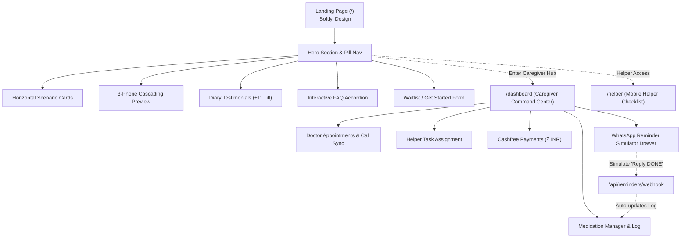

# Elderly Care Coordinator ("Softly") — System Design Specification

## 1. Vision & Problem Statement
Elderly Care Coordinator is a digital living-room wellness and care coordination web platform built for sole earners managing aging parents from another city. It coordinates daily medication schedules, doctor appointments, local helper tasks, and payments—with a mobile-first PWA dashboard and an analog-tactile, "Softly" aesthetic.

---

## 2. Aesthetic & UI Design System ("Softly")

### 2.1 Color Palette
* **Canvas Background**: `#FDFCF8` (Warm tactile cream)
* **Dark Text / Soft Black**: `#292524` (Stone 800)
* **Muted Text**: `#78716C` (Stone 500)
* **Primary Accent (Peach / Coral)**: `#FFB7B2`
* **Secondary Pastels**:
  * Sage: `#E8EFE8`
  * Lavender: `#EFEDF4`
  * Blush Blob: `#FFE4E1`
  * Periwinkle Blob: `#E6E6FA`

### 2.2 Typography
* **Primary Font**: `Outfit` (Clean, rounded sans-serif). Headings at 48px–96px, sentence-case only, tracking-tight (`-0.025em`).
* **Accent Handwritten Font**: `Reenie Beanie` (Whimsical cursive for emotional emphasis, diary signatures, and handwritten notes).

### 2.3 Visual Effects & Textures
* **Grain Overlay**: Viewport-fixed `<div class="pointer-events-none fixed inset-0 z-50 opacity-35 mix-blend-overlay">` with inline SVG fractal noise (`feTurbulence` with `baseFrequency="0.65"`).
* **Border Radii**: Generous pill and pebble curves: `rounded-2xl` to `rounded-3xl` (1.5rem to 2.5rem) and full pills (`rounded-full`).
* **Soft Depth Shadows**: `0 4px 20px -2px rgba(0, 0, 0, 0.05)`.
* **Animations**: Floating ambient blobs (6s loop, translateY ±10px), reveal-on-scroll, pulsing Coral action buttons.

---

## 3. Pages & User Flows



### 3.1 Public Landing Page (`/`)
1. **Floating Pill Nav**: 70% white opacity, 20px backdrop-blur, circular Coral logo with white dot, 14px Outfit medium links, stone `#292524` CTA pill.
2. **Hero Section**: Dual blurred blobs (`#FFE4E1` and `#E6E6FA`), 72px Outfit headline with handwritten *Reenie Beanie* emphasis, dual CTA pills ("Launch Care Hub" in Coral `#FFB7B2`, "Helper Access" in white with stone border).
3. **Horizontal Scenario Scroll**: 288px × 160px white cards (`rounded-3xl`), timestamp in stone-400, headline in stone-800, hover color shifts to pastel accents.
4. **App Experience Preview**: 3-phone cascading mockups. Center phone (300×620px) with pulsing Coral button; left and right phones (280×580px at 80% opacity, +48px and +96px offsets) showcasing Sage and Lavender screens.
5. **Diary Entry Testimonials**: 2-column desktop / 1-column mobile grid. Cards tilted at ±1° mimicking physical paper notes, ending with a horizontal rule and *Reenie Beanie* signature.
6. **Interactive FAQ Accordion**: Smooth expand/collapse with 45° rotating plus icon, stone-100 border, rounded-2xl container.
7. **Waitlist / Get Started**: Full-width gradient section with dark stone rounded-square icon and coral dot, email input + hover-scale black submit button.

### 3.2 Caregiver Command Center (`/dashboard`)
* Accessible via primary navigation or direct URL.
* Unified header with family switcher, role badge ("Caregiver"), quick switch to Helper view, and quick action to share helper link/PIN.
* **Medication Tab/Section**:
  * List active medications with dosage, schedule badges (e.g. 08:00 AM, 08:00 PM), and adherence rates.
  * Modal/Form to add new medication with instructions ("Take after breakfast").
  * 1-click "Trigger Reminder Now" test button.
* **Appointments Tab/Section**:
  * Upcoming doctor appointments with doctor name, clinic address, scheduled date/time, and notes.
  * "Add to Google Calendar" link and ".ics Download" button.
* **Helper Tasks & Cashfree Payments**:
  * Task checklist for local helpers ("Pick up BP medicine from Apollo").
  * Cashfree payment modal with amount in ₹ INR. Initiates Cashfree PG order or triggers instant interactive test payment flow when credentials are not yet set.
* **WhatsApp Interactive Simulator Drawer**:
  * Slide-out drawer displaying outgoing reminder messages.
  * Interactive "Simulate WhatsApp Reply: DONE" button that hits `/api/reminders/webhook` to mark the medication taken in real time.

### 3.3 Helper Mobile Checklist (`/helper`)
* Mobile-optimized high-contrast, large-button checklist designed for local helpers or relatives.
* Today's tasks (Medication reminders to oversee, appointments to accompany).
* Large 1-tap "Mark Given / Attended" buttons.

---

## 4. Technical Architecture & Data Model

### 4.1 Technology Stack
* **Framework**: Next.js 14 (App Router, React 18, TypeScript)
* **Styling**: Tailwind CSS + custom Google Fonts (`Outfit` & `Reenie Beanie`)
* **State / Data**: Supabase PostgreSQL with local mock repository fallback
* **Payments**: Cashfree Payments PG (Order API + JS SDK + Test Simulator)
* **Notifications**: Twilio WhatsApp API + In-App Interactive Webhook Simulator
* **PWA**: Web App Manifest (`manifest.json`), service worker registration, offline shell caching

### 4.2 Database Schema
```sql
CREATE TABLE families (
  id UUID PRIMARY KEY DEFAULT gen_random_uuid(),
  name TEXT NOT NULL,
  invite_code TEXT UNIQUE NOT NULL,
  created_at TIMESTAMPTZ DEFAULT NOW()
);

CREATE TABLE family_members (
  id UUID PRIMARY KEY DEFAULT gen_random_uuid(),
  family_id UUID REFERENCES families(id) ON DELETE CASCADE,
  user_id UUID,
  role TEXT NOT NULL CHECK (role IN ('caregiver', 'elder', 'helper')),
  name TEXT NOT NULL,
  phone TEXT,
  city TEXT
);

CREATE TABLE medications (
  id UUID PRIMARY KEY DEFAULT gen_random_uuid(),
  family_id UUID REFERENCES families(id) ON DELETE CASCADE,
  name TEXT NOT NULL,
  dosage TEXT NOT NULL,
  schedule TEXT[] NOT NULL, -- e.g. ['08:00', '20:00']
  instructions TEXT,
  active BOOLEAN DEFAULT TRUE,
  created_at TIMESTAMPTZ DEFAULT NOW()
);

CREATE TABLE medication_logs (
  id UUID PRIMARY KEY DEFAULT gen_random_uuid(),
  medication_id UUID REFERENCES medications(id) ON DELETE CASCADE,
  family_id UUID REFERENCES families(id) ON DELETE CASCADE,
  taken_at TIMESTAMPTZ DEFAULT NOW(),
  taken_by_name TEXT,
  status TEXT NOT NULL CHECK (status IN ('taken', 'missed', 'skipped')),
  channel TEXT DEFAULT 'app' -- 'app' | 'whatsapp'
);

CREATE TABLE appointments (
  id UUID PRIMARY KEY DEFAULT gen_random_uuid(),
  family_id UUID REFERENCES families(id) ON DELETE CASCADE,
  title TEXT NOT NULL,
  doctor_name TEXT NOT NULL,
  clinic_address TEXT,
  scheduled_at TIMESTAMPTZ NOT NULL,
  helper_name TEXT,
  status TEXT DEFAULT 'scheduled' CHECK (status IN ('scheduled', 'completed', 'cancelled')),
  notes TEXT
);

CREATE TABLE helper_tasks (
  id UUID PRIMARY KEY DEFAULT gen_random_uuid(),
  family_id UUID REFERENCES families(id) ON DELETE CASCADE,
  title TEXT NOT NULL,
  description TEXT,
  due_date TIMESTAMPTZ,
  completed BOOLEAN DEFAULT FALSE,
  assigned_to TEXT
);

CREATE TABLE helper_payments (
  id UUID PRIMARY KEY DEFAULT gen_random_uuid(),
  family_id UUID REFERENCES families(id) ON DELETE CASCADE,
  order_id TEXT NOT NULL,
  payment_session_id TEXT,
  amount_inr NUMERIC(10, 2) NOT NULL,
  status TEXT DEFAULT 'created' CHECK (status IN ('created', 'paid', 'failed')),
  purpose TEXT,
  created_at TIMESTAMPTZ DEFAULT NOW()
);
```

### 4.3 API Endpoints
* `GET/POST /api/medications`: List and create medications.
* `POST /api/medications/log`: Log medication intake status.
* `GET/POST /api/appointments`: List and create doctor appointments.
* `GET/POST /api/tasks`: List and update helper tasks.
* `POST /api/payments/cashfree-order`: Create a Cashfree order (returns `order_id` and `payment_session_id`).
* `POST /api/payments/cashfree-verify`: Verify payment status from Cashfree webhook or redirect.
* `POST /api/reminders/trigger`: Trigger medication WhatsApp reminders (Cron or manual).
* `POST /api/reminders/webhook`: Inbound WhatsApp webhook (processes "DONE" replies).

---

## 5. Testing & Verification Plan
* **Unit & Component Tests**:
  * Jest test suite testing data repository methods, Cashfree order creation, and WhatsApp webhook parser.
* **Manual Verification Checklist**:
  1. Visit `/` to experience the full "Softly" landing page with grain texture, floating blobs, cursive accents, and scenario scroll.
  2. Click "Launch Care Hub" to enter `/dashboard`.
  3. Add a new medication and verify it displays on the active list.
  4. Trigger a WhatsApp test reminder; verify it appears in the simulator drawer.
  5. Click "Reply DONE" in the drawer; verify the medication log updates to "Taken".
  6. Add a doctor appointment; test the Google Calendar / `.ics` export.
  7. Add a helper task, and trigger a Cashfree helper payment order.
  8. Switch to `/helper` and verify the mobile checklist view updates live.
